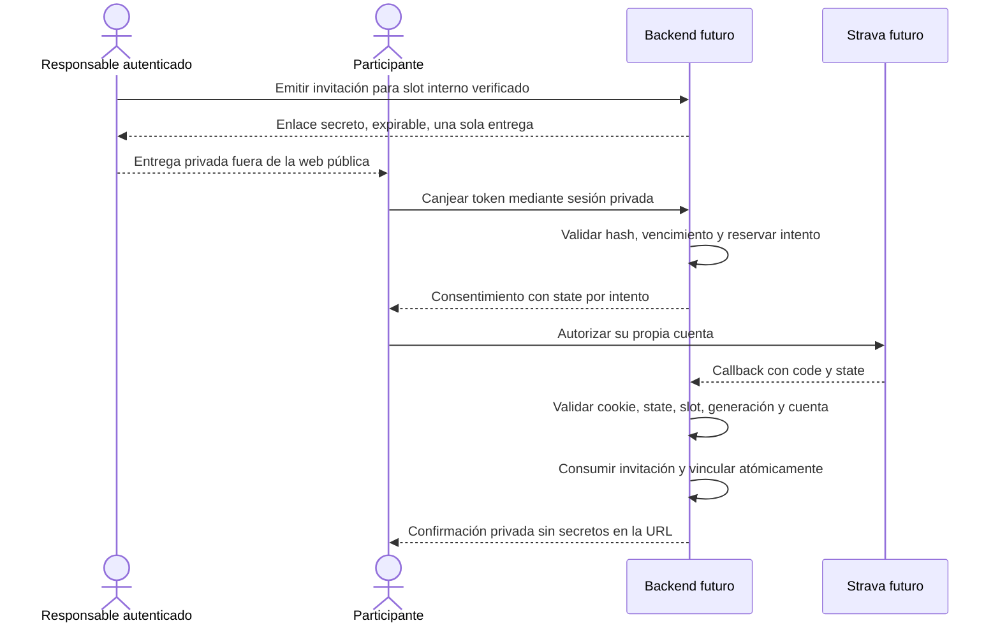

# Invitaciones privadas: diseño y prototipo local

Esta entrega es un **modelo local**, sin endpoints OAuth operativos, intercambio
de códigos, llamadas a Strava, secretos reales ni persistencia. El reductor
`auth/invitation-machine.js` consume eventos ficticios ya validados por un
adaptador confiable y devuelve estado, resultado y efectos. No constituye un
servicio de autenticación listo para producción.

## Flujo previsto



Los dos slots son `slot-a` y `slot-b`, internos y ficticios. La URL nunca decide
el slot: lo determina exclusivamente el registro de invitación del backend.
No habrá un botón público de vincular cuentas en GitHub Pages. Ninguna respuesta
pública enumera slots, cuentas, actividades o aportaciones individuales.

## Identidad y cuenta correcta

La posesión de una invitación permite iniciar **ese intento de vinculación**, pero
no prueba identidad para solicitar supresión ni autoriza otra cuenta arbitraria.
El modelo exige `expectedAccountHash` al emitir cada enlace. En fixtures representa
un registro confiable previo; no es una solución automática de identidad.

Antes de OAuth real hay que implementar uno de estos mecanismos bajo control del
responsable: un registro previo verificado de la cuenta esperada o una confirmación
privada del responsable tras identificar al titular y comprobar la cuenta propuesta.
La segunda opción dejaría la vinculación pendiente hasta esa confirmación. No basta
un nombre, correo o ID editable en la URL, ni la primera cuenta que abra el enlace.
No se piden contraseñas ni credenciales de Strava a Alberto o Belén. Un hash conserva
la necesidad de proteger y verificar la información original: no convierte una
entrada aportada por el cliente en un dato confiable. La forma concreta de verificar
ese registro es un requisito pendiente de la futura integración real.

En el prototipo, la cuenta del callback debe coincidir con el hash esperado y con
cualquier vinculación previa del mismo slot; tampoco puede estar asociada al otro.
Una cuenta equivocada no consume el enlace y permite repetir el consentimiento.
Cambiar deliberadamente de cuenta tras supresión exige registro verificado nuevo,
invitación nueva y consentimiento nuevo; nunca se importan datos antiguos por defecto.

## Tokens, intentos y uso único

`newSecret()` genera 32 bytes aleatorios criptográficos (256 bits) codificados en
base64url. Invitaciones, `state` y cookies deben usar secretos independientes.
`hashSecret()` genera SHA-256. El estado persistible guarda únicamente hashes; el
secreto original solo se entrega una vez por el canal privado. No se almacena el
código OAuth ni ningún access/refresh token en este prototipo.

Una invitación dura como máximo 24 horas; un intento dura como máximo 10 minutos
y nunca más que su enlace. Los tiempos se suministran desde el reloj del backend,
no desde parámetros del navegador. El registro de intento liga hash de `state`,
hash de sesión, slot, invitación y generación. Un doble clic no crea dos intentos
concurrentes: devuelve `attempt_in_progress` mientras la reserva siga vigente.

Abrir el enlace **no lo consume**. Cancelar OAuth o agotar el intento permite otro
intento dentro del vencimiento del enlace. Cada intento necesita `state` nuevo.
Un callback expirado no puede liberar la reserva de un intento posterior. `state`
incorrecto, cookie de otra sesión, callback repetido o parámetros que intenten
seleccionar otro slot se rechazan. La invitación solo se consume tras una
vinculación satisfactoria; usada o revocada no puede reactivarse. Reemitir revoca
las invitaciones aún activas del slot y crea un token distinto.

El modelo limita a cinco intentos inválidos por minuto por hash de sesión. **Ese
hash debe derivarse de una sesión asignada y validada por el backend**, nunca de
una cabecera o parámetro elegible por el cliente. La sesión de un invitado no
identifica todavía al titular. Antes de producción habrá que combinar límites
por sesión con controles de abuso de red, emisión y canje, y limpieza por TTL:
no basta con que un cliente rote cookies. El reductor no implementa esos controles.

## Adaptador OAuth futuro

El callback público del proveedor recibe código y `state`; el adaptador futuro
comprobará la cookie de intento, expiración y `state`, intercambiará el código en
backend y verificará la cuenta y permisos realmente devueltos por el proveedor.
Solo entonces construirá el evento local `callback` con `providerStatus: valid`.
Esos campos y las afirmaciones `actor.authenticated`, `verified` y `requestVerified`
son **decisiones internas confiables**, no flags que un endpoint aceptaría del
JSON o query del visitante. Una prueba con fixtures no demuestra autenticación
real, aislamiento de secretos o validación real del proveedor.

Solicitar solo lectura de actividades, incluidas privadas cuando esté autorizado
(`activity:read_all` en el contrato local); no permiso de escritura. La integración
real deberá contrastar los permisos vigentes con la documentación oficial antes
de habilitarlos. La falta de permiso suficiente no vincula silenciosamente una
cuenta como completa. Tokens reales solo en backend, protegidos por mecanismos
del proveedor y nunca en frontend, configuración pública, PR, logs o fixtures.

## Atomicidad y carreras

El reductor es puro: no muta su entrada y **no proporciona atomicidad de base de
datos**. Dos procesos que lean el mismo snapshot pueden producir decisiones
válidas incompatibles si el almacenamiento aplica ambas sin coordinación.

La futura persistencia debe transaccionar reserva, consumo, vínculo único y
versión/generación mediante CAS o transacción con restricciones únicas: un slot
activo por cuenta, una cuenta por slot, una sola transición `reserved → used` y
un único intento vigente. Si falla el CAS, releer y reevaluar; no repetir efectos
externos como si hubiera triunfado. La serialización en memoria del Worker local
de #14 valida el contrato de efectos dentro de ese proceso; no demuestra una
transacción distribuida ni implementa D1. No se incluyen migraciones SQL aquí.

## Revocación y supresión son distintas

**Revocar OAuth:** invalidar credenciales y trabajos del slot, aumentar generación,
inutilizar intentos pendientes y mantener provisionalmente su último agregado
solo en el total conjunto. El público puede ver `partial: true` y `stale: true`
a la vez. No consultar esa cuenta sin autorización. La invitación consumida sigue
consumida. El responsable puede emitir otra, con consentimiento nuevo y la cuenta
correcta. La siguiente reconciliación será completa desde el inicio del reto,
incluyendo cambios y borrados, no solo nuevas actividades.

**Suprimir datos:** requiere sesión autenticada y autorización del titular para
su propio slot, o actuación del responsable sobre una solicitud expresamente
verificada (`requestVerified`). Un token de invitación por sí solo no vale.
El soporte futuro debe ofrecer un canal privado accesible, comprobar identidad y
registrar la decisión mínima de verificación sin publicar datos de la otra persona.

Tras verificarse, se eliminan credenciales, actividades y aportaciones; se recalcula
el total sin el slot. El modelo borra hash de cuenta y registro esperado, intentos
e invitaciones asociados, aumenta generación y conserva únicamente la marca
operativa de supresión. Un segundo borrado es idempotente. Los hashes retirados de
tokens evitan reutilización, sin conservar su asociación al slot. Por defecto se
mantienen hitos del reto compartido; si la evaluación de la solicitud exige borrar
o anonimizar también esos hechos, `purgeMilestones` debe ser una decisión interna
verificada. No hay participantes individuales en respuestas públicas.

Antes de producción hay que fijar una política concreta de retención y borrado:
credenciales y actividad suprimidas en el almacén principal, caducidad de intentos,
sesiones y contadores, metadatos mínimos de prevención de replay, trazas de soporte,
plazos y tratamiento de copias de seguridad. La restauración de una copia debe
reaplicar las marcas de supresión antes de permitir sincronizaciones. No se afirma
que este modelo efímero resuelva obligaciones legales ni borrado físico de backups.

## Contrato con #13 y #14

La PR se apila sobre la rama de #14, que a su vez depende de #13. No se copia su
implementación. `tests/invitations.test.js` importa el Worker local y la política.
Los efectos privados consumen `worker.applyLocalEvent(event)`:

| Evento de la máquina | Efecto privado de política | Generación |
| --- | --- | --- |
| Callback válido | `connected`, scopes mínimos | Actual |
| Revocación | `revoked` | Usa la anterior; el slot incrementa |
| Supresión verificada | `deleted`, `verified: true` | Usa la anterior; el slot incrementa |
| Consentimiento nuevo tras supresión | `connected`, `verified: true`, `newConsent: true` | Usa la generación de supresión; se incrementa otra vez |

Los flags son resultado del adaptador confiable, nunca una autorización pública.
Los trabajos encolados conservan la generación original; no se cambia su número
para intentar que vuelvan a funcionar. Tras borrado y nuevo consentimiento, el
slot parte sin datos y únicamente admite trabajo nuevo de la nueva generación.
Las pruebas verifican que callbacks y snapshots anteriores no resucitan datos y
que el otro slot permanece independiente. No hay timestamps de premios ni
transferencia de hitos de prueba al reto real.

El contrato público continúa agregado: distancia conjunta, estados genéricos,
última actualización y IDs de hitos; no publica cuentas ni actividad. Las reglas
Run/Walk/Hike, exclusión manual, inicio inclusivo Europe/Madrid, deduplicación y
reconciliación siguen en #13. La referencia local es **2026-11-01**; 500 km desde
2026-11-28 son planificación definitiva, no valores que se escriban aquí en el juego.

## API propuesta y DDEV

Estos endpoints son **diseño, no rutas implementadas**:

| Ruta prevista | Control requerido |
| --- | --- |
| `POST /admin/invitations` | Responsable autenticado, CSRF, slot interno y verificación de cuenta |
| `POST /invite/start` | Token vigente, sesión privada válida, limitación de intentos |
| `GET /oauth/callback` | Cookie de intento, state, vencimiento y validación real del proveedor |
| `POST /connection/revoke` | Titular autenticado para ese slot o responsable autorizado |
| `POST /privacy/delete` | Solicitud verificada, autenticación, autorización y CSRF |

El enlace privado puede transportar el token en el fragmento para que no llegue
a logs HTTP/Referer. Una página privada de canje sin analytics lo enviaría por POST
al backend y lo retiraría inmediatamente de la URL con `history.replaceState`.
El fragmento no elimina el riesgo de compartir el enlace, extensiones o copiar el
historial: es un secreto hasta canjearse. No incluirlo en query, HTML público,
telemetría ni redirecciones. Aplicar `Referrer-Policy: no-referrer`, `Cache-Control:
no-store`, CSP restrictiva y cookies HttpOnly/Secure/SameSite apropiadas para el
callback. Sanitizar logs de URL/códigos y redirigir tras el callback a una URL
limpia. No guardar `code`, token de enlace o state en localStorage del juego.

El origen existente es `https://albertoybelen.ddev.site/`. La URI prevista es
`https://albertoybelen.ddev.site/oauth/callback`; el dominio registrado previsto es
`albertoybelen.ddev.site`. **No se ha añadido el handler ni se ha configurado el
router DDEV en esta PR.** Cuando se autorice una fase real habrá que enrutar esa
ruta al backend dentro de DDEV y verificar HTTPS, cookies y redirecciones en su
navegador local. No se añade otro servidor ni se afirma haber probado ese recorrido.

## Ejecutar las pruebas y revisar la dependencia

```sh
npm test
node --test tests/invitations.test.js
node --check auth/invitation-machine.js
git diff --check
```

Las fixtures son cadenas y actividades sintéticas, sin cuentas o IDs personales.
Las pruebas incluyen permisos, state, sesión cruzada, cuenta errónea/duplicada,
expiración, cancelación, doble clic, replay, reemisión, revocación, borrado repetido,
no resurrección e integración en memoria con el Worker. No requieren instalación,
cuentas, claves, navegador ni servicios externos. No se pide OAuth real.

Revisar/mergear primero #13, después #14 y finalmente #15. Tras aprobar #13 se
retargetea #14 a main; tras aprobar #14, retargetear esta PR a main y actualizar su
base antes de revisar el diff final. No hacer cherry-pick de los módulos dependientes
como implementación propia de #15.

## Puertas pendientes para producción

Requieren nuevas issues y autorización: prueba de identidad, endpoints HTTPS,
almacenamiento transaccional y cifrado, política de retención/supresión/backups,
validación real del proveedor, control de abuso, observabilidad sin secretos y
revisión de privacidad. D1 de producción `albertoybelen-db` está reservada y no se
toca; staging es futuro y necesita autorización separada. No se implementa D1,
no se ejecuta SQL ni se activa Cron, facturación, OAuth real o despliegues. Worker
previsto `albertoybelen-api`, binding futuro `DB`; coste adicional autorizado **0 €**.
